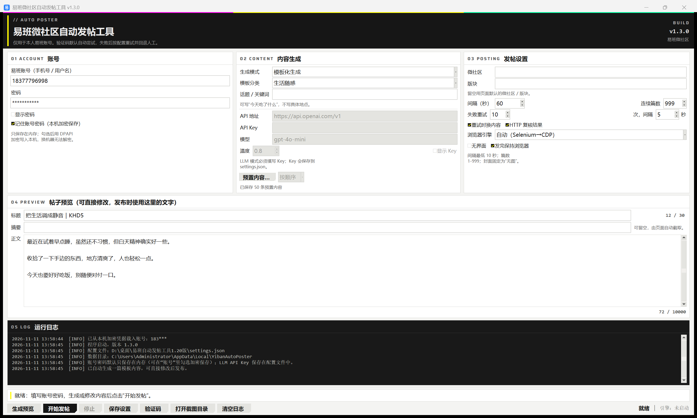

# 易班微社区自动发帖工具 · Yiban AutoPoster

> **易班（yiban）微社区自动发帖工具 / 易班发帖机 / 易班每日自动刷网薪 / 易班自动发帖脚本 / yiban auto poster**
> 关键词：易班 ｜ yiban ｜ 易班网薪 ｜ 网薪 ｜ wangxin ｜ 刷网薪 ｜ 每日任务 ｜ 易班微社区 ｜ 微社区 ｜ weishequ ｜ 自动发帖 ｜ 发帖工具 ｜ 发帖机 ｜ 易班网 yiban.cn ｜ 校园 ｜ 大学生 ｜ 自动化 ｜ Selenium ｜ CDP ｜ Tkinter ｜ Python ｜ Windows ｜ 图形验证码 ｜ 数美滑块

面向**易班网薪**的每日自动化：每天自动登录、自动生成内容、自动在微社区发帖，把「每日发帖 / 每日任务」这类需要手动重复的动作交给程序完成，用来稳定积累易班网薪与活跃度。

Windows 桌面工具：填入**你本人**的易班账号，自动登录 → 自动生成内容 → 自动填写 → 提交 → 检测结果。
打包为单文件 `exe`，双击即用，不需要安装 Python。界面为终末地（Endfield）风格的纸色控制台。

> ⚠️ 仅用于操作**你本人**的易班账号。请遵守平台规则，不要用于刷屏、广告或批量操控他人账号。



## 功能

- **三种内容生成方式**：模板化（日常寒暄 / 生活随感 / 古诗词 / 随机字母数字）、OpenAI 兼容 LLM、手动预置文案（按顺序或随机取用；编辑器支持**导入 / 导出** `.txt` / `.json`）
- **自带 9 套预置文案包**（`presets/`）：正能量 60 条、正能量 2000 条、古诗 4000 首（含读后感）、古诗词文言文 2000 首、意林风 300 篇、报刊短文 700 篇、穿越短篇 100 章、抽象语录 400 句
- **自动登录**：先打开发帖页，未登录自动填表并提交；支持传统表单与 SPA 两种登录页
- **自动发帖**：标题、摘要、wangEditor 正文、微社区 / 版块下拉、草稿恢复弹窗、封面“无图”全部自动处理
- **结果检测**：成功提示 / 页面跳转 / 发帖接口三路证据；失败输出服务端错误码（如频率限制 `-1002`）
- **失败重试**：可配置重试次数与间隔，可选“重试时换内容”，避免“相同标题”
- **验证码策略**（按顺序尝试，失败逐级回退）：
  1. 外接 HTTP / 本地程序识别服务（坐标点选协议）
  2. **离线识图**：纯 Python 解码截屏 → 颜色连通域 → 填充率 / 宽度轮廓 / 竖直棱亮度突变 → 判断 圆锥 / 圆柱 / 方体 / 球，解析“最小的蓝色六棱柱”这类题面
  3. **视觉模型**：OpenAI 兼容、支持图片输入的模型，返回归一化坐标
  4. ddddocr 文字点选（可选依赖）
  5. 滑块轨迹模拟
  6. 人工接管（可关闭）
- **点击一定用可信事件**（v1.2.2 修复）：CDP `Input.dispatchMouseEvent` → W3C Actions → DOM 事件三层回退，点完立即校验“验证码有没有反应（图换没换、框消没消失）”，连续两次“点了没反应”直接转人工，不再空转
- **真实鼠标点击**：验证码点击走 Windows `SendInput`；换算基准取网页内容子窗口 `Chrome_RenderWidgetHostHWND` 的客户区，进程声明 Per-Monitor V2 DPI 感知，换机器 / 换缩放不偏
- **可选的凭据保存**：勾选后用 Windows DPAPI 加密存本机，换用户 / 换机器无法解密
- **可配置**：`settings.json` 保存间隔、篇数（1–999）、重试、LLM、验证码等非敏感配置；日志同时写 GUI 与文件

## 快速开始

1. 到 [Releases](../../releases) 下载 `YibanAutoPoster-vX.Y.Z.zip`，解压到普通目录（桌面、文档均可，不要放 `Program Files`）
2. 双击 `YibanAutoPoster.exe`
3. 在 **01 ACCOUNT 账号** 填账号密码 → 在 **02 CONTENT 内容生成** 选生成方式 → 点「生成预览」（可改）→ 点「开始发帖」

首次运行若出现 SmartScreen，点「更多信息 → 仍要运行」（未签名单文件程序的正常提示）。

## 预置文案

**02 CONTENT 内容生成** → 生成模式选 **手动预置内容** → 点「预置内容…」：

- 左下角「导入…」读 `.txt` / `.json`，会问「追加还是替换」；「导出…」把当前列表存成文件
- 右边的「按顺序 / 随机」决定发帖时怎么取用

软件 `presets/` 目录自带：

| 文件 | 条数 | 说明 |
|---|---|---|
| `正能量预置内容.txt` / `.json` | 60 | 精选，8 个题材 |
| `正能量预置内容2000.txt` / `.json` | 2000 | 10 个题材各 200 条，正文 23～120 字 |
| `古诗4000-读后感触.txt` | 4000 | 全唐诗 + 繁体转简体，每首附读后感 |
| `古诗词文言文2000.txt` | 2000 | 唐诗 / 宋词 / 元曲 / 诗经 / 楚辞 / 论语 |
| `意林风-短文鉴赏300篇.txt` | 300 | 原创仿写，附「鉴赏：」 |
| `报刊短文鉴赏700篇.txt` | 513 | 原创仿写，12 个骨架 |
| `穿越致富100章.txt` | 100 | 连载式短篇 |
| `抽象语录400句.txt` | 400 | 原创，敏感词已过滤 |

txt 格式：每条之间空一行，第一行是标题，其余是正文，`【1】` 这类序号会自动忽略。

## 从源码运行

```bash
pip install -r requirements.txt
python main.py
```

自检（不登录、不发帖）：

```bash
python main.py --selftest-basic     # 环境与模块
python main.py --selftest           # 含浏览器：无界面打开登录页并截图
python main.py --selftest-headful   # 含浏览器：带界面
```

## 打包

```bat
build.bat
```

等价命令：

```bat
pyinstaller --noconfirm --clean --onefile --windowed --name YibanAutoPoster ^
  --icon assets\yiban.ico --add-data "assets;assets" ^
  --add-data "presets;presets" ^
  --collect-submodules selenium --hidden-import websocket ^
  --hidden-import websocket._core main.py
```

## 技术结构

```
main.py                 入口（GUI / 自检 / 崩溃日志）
yiban_auto/
  gui.py                Tkinter 界面（终末地风格）
  efui.py               自绘界面部件：切角按钮、面板、眉标、等宽数字、复选框对勾
  flow.py               登录、填表、提交、结果判定
  content.py            模板 / LLM / 预置内容
  captcha.py            验证码调度：外接服务、离线识图、视觉模型、OCR、滑块
  captcha_cv.py         纯 Python PNG 解码 + 颜色连通域 + 形状判定
  sysmouse.py           Windows SendInput 真实鼠标点击
  verify.py             用浏览器 Cookie 走 HTTP 旁路复核
  secure_store.py       DPAPI 加密保存账号密码
  browser/
    cdp.py              直接驱动本机 Edge/Chrome（DevTools 协议，无需 WebDriver）
    selenium_engine.py  Selenium 路线
    __init__.py         auto：Selenium 失败自动回落 CDP
assets/fonts/Saira.ttf  OFL 字体，界面英文眉标用
presets/                自带预置文案（9 套）
```

浏览器默认用 CDP 直接驱动本机 Edge，不下载 WebDriver，也不会留下 `navigator.webdriver`。

## 配置要点

完整字段见 `settings.json` 与 `README.txt`。常用项：

| 字段 | 说明 |
|---|---|
| `posting.interval_seconds` | 两篇间隔，最小 10 秒 |
| `posting.repeat_count` | 单次最多 999 篇 |
| `posting.retry_count` / `retry_interval_seconds` | 失败重试次数与间隔 |
| `posting.regenerate_on_retry` | 重试时换一版内容 |
| `content.mode` | `template` / `llm` / `preset` |
| `captcha.mode` | `auto` / `manual` / `http` / `command` |
| `captcha.auto_cv` | 离线识图开关 |
| `captcha.click_mode` | `system`（真实鼠标）/ `browser` |
| `captcha.vision` | 视觉模型地址 / Key / 模型名，留空复用 `content.llm` |
| `security.remember_credentials` | 是否用 DPAPI 保存账号密码 |

## 版本

- **v1.3.0**：界面按终末地风格重做（纸色 + 白面板 + 1px 细线 + 单一强调色、切角按钮、深色命令栏与日志区），功能与配置不变
- **v1.2.2**：验证码点击改为可信事件三层回退 + 点击效果校验，连续两次没反应转人工
- **v1.2.1**：连续篇数上限提到 999
- **v1.2.0**：预置内容导入 / 导出、2000 条正能量包、篇数上限

## 边界与已知限制

- 图形点选靠规则识别，**图形重叠、只写形状不写颜色、出现规则外图形**时会失败，工具会换图重试并回退到视觉模型 / 人工
- 短信验证、人脸识别、身份验证无法自动化，会转人工
- 平台前端改版可能导致定位失败；失败现场会保存截图、HTML 与接口记录
- 高频发帖会被平台限制，请遵守社区规范

## License

MIT
